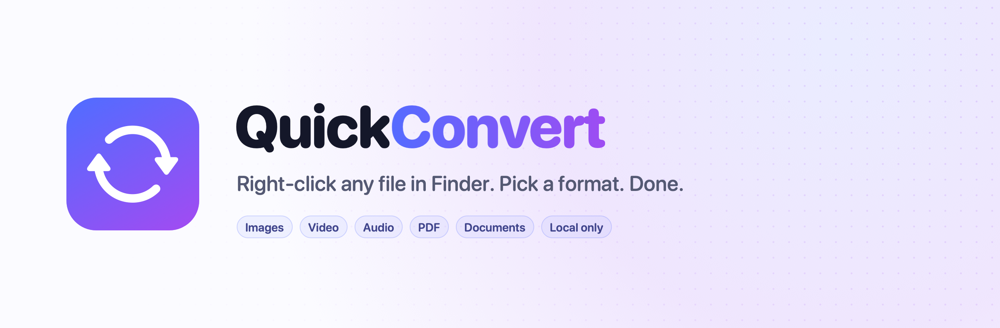
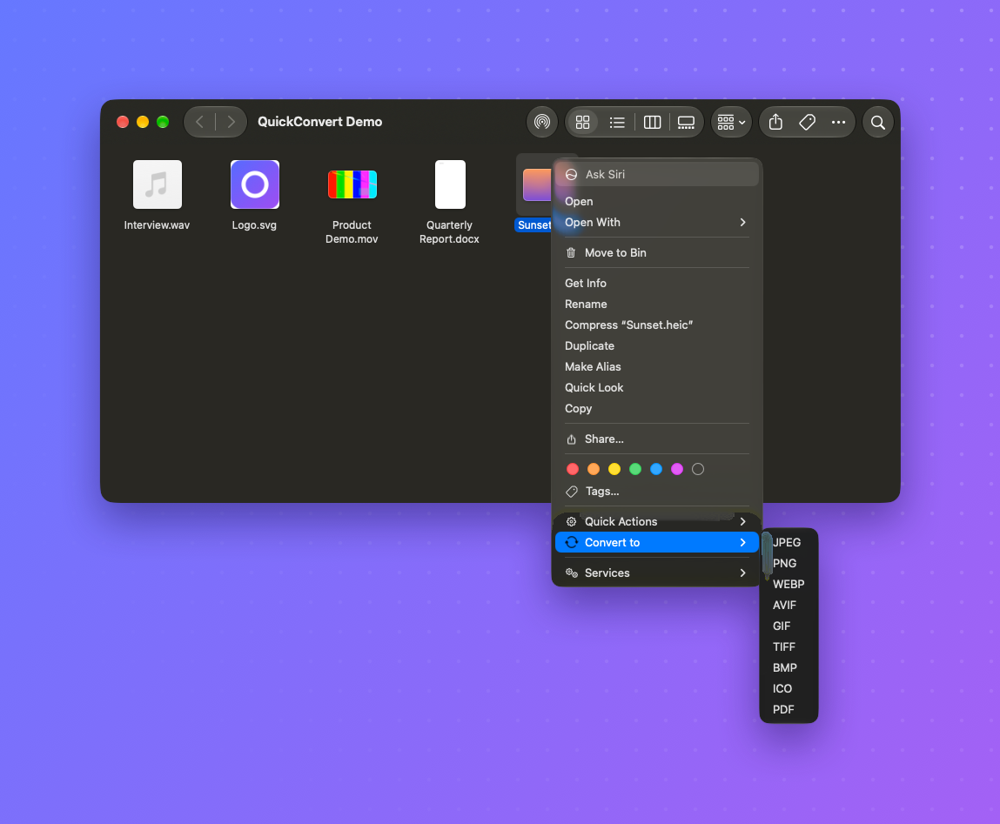
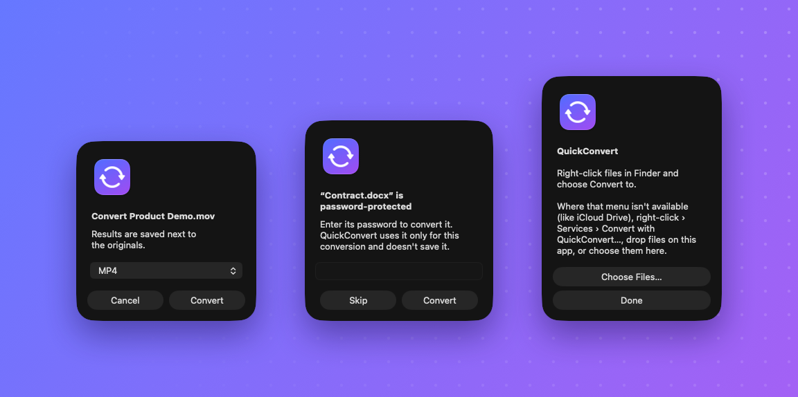
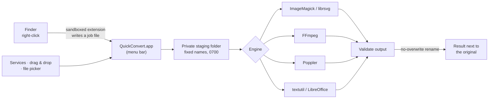

<p align="center">
  <picture>
    <source media="(prefers-color-scheme: dark)" srcset="docs/banner-dark.png">
    
  </picture>
</p>

<p align="center">
  <a href="https://github.com/jgreen417/QuickConvert/actions/workflows/build.yml"></a>
  
  
  
  
  <a href="LICENSE"></a>
</p>

<p align="center">
  <b>QuickConvert</b> adds a <b>Convert to</b> menu to Finder. Right-click photos, videos, audio, PDFs or documents,<br>
  choose a format, and the result appears right next to the original. Everything runs on your Mac.
</p>

<p align="center">
  
</p>

---

## Highlights

- **Right where you already are.** A native Finder menu, with only the formats that fit what you selected. Each file type lists its most common format first.
- **Quality first.** Streams that already fit are copied bit-for-bit instead of re-encoded. Lossless stays lossless, and re-encodes use high-quality settings.
- **Private by design.** Your files never leave your Mac. No accounts, no uploads, no telemetry.
- **Never overwrites.** Results go to `name.ext`, then `name 2.ext`. Failed jobs leave nothing behind.
- **Handles the awkward files.** Password-protected Office documents, animated images, multi-page PDFs, odd-sized videos, multitrack video with subtitles, album art, and files on external drives.
- **Works in iCloud Drive too,** through Services, drag-and-drop, or the file picker, where macOS hides Finder extension menus.
- **Universal app** for Apple silicon and Intel, built with Swift and AppKit, with no third-party Swift dependencies.

<p align="center">
  
</p>

## Ways to convert

| Where | How |
|---|---|
| Most folders | Right-click › **Convert to ›** *format* |
| iCloud Drive and other cloud folders | Right-click › **Services › Convert with QuickConvert…** |
| Anywhere | Drop files on QuickConvert.app, or open it and click **Choose Files…** |

While it works, a menu-bar icon shows progress (a live percentage for audio and video) with a **Cancel All** item. It chimes when done, explains anything that failed, and quits when idle.

## Install

### Homebrew (recommended)

```bash
brew install jgreen417/tap/quickconvert
quickconvert setup
```

Homebrew builds QuickConvert on your Mac and installs the conversion engines (FFmpeg, ImageMagick, Poppler, librsvg) as dependencies. `quickconvert setup` copies the app to `~/Applications`, enables the Finder extension, and relaunches Finder. Run it again after `brew upgrade quickconvert`.

For Word, Excel, PowerPoint, Keynote and Numbers files, and for converting anything to PDF, also install LibreOffice:

```bash
brew install --cask libreoffice
```

### From source

You'll need macOS 13 or later, the Xcode command-line tools, and the engines above.

```bash
git clone https://github.com/jgreen417/QuickConvert.git
cd QuickConvert
./build.sh
```

`build.sh` signs with your Apple Development certificate if you have one, and ad-hoc otherwise. Either way works on your own Mac.

### If Convert to doesn't appear

1. Open **System Settings › General › Login Items & Extensions › Finder** and check QuickConvert is switched on.
2. Relaunch Finder with `killall Finder`. Finder can keep using an older copy of the extension after a reinstall.

## Formats

| From | To | Engine |
|---|---|---|
| JPEG, PNG, WebP, HEIC, AVIF, GIF, TIFF, BMP, ICO, TGA, PSD, QOI, EXR, PPM | JPEG, PNG, WebP, HEIC, AVIF, GIF, TIFF, BMP, ICO, PDF | ImageMagick |
| SVG | PNG, JPEG, WebP, PDF | librsvg + ImageMagick |
| PDF | PNG, JPEG (one image per page, 300 DPI) | Poppler |
| MP4, MOV, M4V, WebM, MKV, AVI, FLV, WMV, MPEG, 3GP | MP4, MOV, WebM, MKV, GIF, MP3, M4A, WAV | FFmpeg |
| MP3, WAV, FLAC, AAC, M4A, OGG, Opus, AIFF, WMA, CAF | MP3, M4A, WAV, FLAC, AAC, OGG, Opus, AIFF | FFmpeg |
| TXT, RTF, DOC, DOCX, ODT, HTML | PDF*, DOCX, DOC, ODT, RTF, TXT, HTML | textutil / LibreOffice |
| PPTX, PPT, ODP, KEY | PDF, PPTX, ODP | LibreOffice* |
| XLSX, XLS, ODS, CSV, NUMBERS | PDF, XLSX, ODS, CSV | LibreOffice* |

<sub>* Needs LibreOffice. Without it, those targets simply don't appear in the menu.</sub>

With several files selected, the menu offers only formats that work for all of them.

## Quality

QuickConvert keeps as much quality as the target format allows.

| | |
|---|---|
| **No needless re-encoding** | If the streams already fit the target (say H.264/AAC from MOV to MP4, or AAC to M4A), they're copied bit-for-bit. That's lossless and nearly instant. |
| **Lossless stays lossless** | PNG, TIFF, GIF and SVG to WebP use lossless WebP. WAV and AIFF output is 24-bit. |
| **High-quality re-encodes** | JPEG 95 with full color resolution, photo WebP 95, HEIC/AVIF 90, H.264 CRF 18 (visually lossless), VP9 CRF 24, MP3 V0, AAC 256k, Opus 192k |
| **Kept** | Photo metadata and color profiles (with EXIF rotation applied), every video and audio track, subtitles where the container supports them, and album art for MP3, M4A and FLAC |
| **Format limits** | GIF is 256 colors (output at 960px, 15fps). ICO is at most 256px. Single-image formats take an animation's first frame. H.264 needs even dimensions, so odd-sized videos lose one pixel row or column. |

## Privacy & safety

- **Nothing is uploaded.** Every engine runs locally, and QuickConvert itself makes no network requests.
- **Engines never see your filenames.** Each job runs in a private temporary folder under fixed names, so a name like `photo%03d.png` can't trigger ImageMagick or FFmpeg pattern expansion.
- **Outputs are checked before they appear.** A result must exist, be non-empty, and (for PDFs) include every page. It's then moved into place with a rename that never replaces an existing file.
- **Permissions carry over.** A private (`0600`) file produces a private output.
- **Passwords aren't kept.** A document password is passed only to that one LibreOffice process, through its environment, and never saved or logged.
- **Only you can start a conversion.** The Finder extension hands jobs over through its own sandboxed folder, and the `quickconvert://` link carries only a one-time ID. A link from a website or another app can't name files.
- **Bad input is rejected up front:** missing files, folders, named pipes, unreadable files, damaged documents, and unsupported format pairs. Document engines are stopped if they stall, and **Cancel All** stops everything else.

## How it works



The **Finder extension** is sandboxed, as macOS requires, so it can't write next to your files. It only builds the menu and hands the job over. The **host app** is a small menu-bar agent that does the work and quits when idle.

## Testing

```bash
Tests/run.sh         # 79 converter checks through the real engines
Tests/lifecycle.sh   # 24 app checks against the installed app (run after ./build.sh)
QC_ARCH=x86_64 Tests/run.sh   # the same, as Intel code under Rosetta
```

- **`run.sh`** generates its own sample files and covers every format family, LibreOffice and Keynote, password-protected and damaged documents, concurrency, stream preservation, the safety rules above, and APFS, HFS+, exFAT and FAT32 volumes.
- **`lifecycle.sh`** drives the real app through jobs arriving while a dialog is open, long jobs, Cancel All, password prompts, forged links, and rejections. It uses a test mode that only a local `open --env` launch can enable.

## Project layout

```
App/            Host app: job intake, dialogs, menu-bar progress, Converter (staging, engines, publishing)
Extension/      Finder Sync extension (sandboxed): builds the menu, writes job files
Shared/         Format catalog and job model used by both
Tests/          End-to-end suites and fixture helpers
Tools/          Icon and brand artwork generators
bin/quickconvert  Installs (setup) or removes (uninstall) the app and Finder extension
build.sh          Builds universal binaries and signs them; then runs quickconvert setup
uninstall.sh      Same as quickconvert uninstall
```

## Uninstall

```bash
quickconvert uninstall               # or ./uninstall.sh from a source checkout
brew uninstall quickconvert          # if you installed with Homebrew
```

Files you've converted are left alone.

## Known limits

- QuickConvert is built on your own Mac (by Homebrew or `build.sh`), so it doesn't need Apple notarization. A prebuilt, downloadable app would need Developer ID signing and notarization.
- Engines are found in `/opt/homebrew/bin`, `/usr/local/bin` or `/usr/bin`.
- Folders aren't converted recursively. Select the files inside them instead.
- Very long media jobs have no time limit. Use **Cancel All** if you change your mind.
- Tested on macOS 27. The minimum deployment target is macOS 13, but older versions haven't been tested.

## License

[MIT](LICENSE) © 2026 Josh Green
