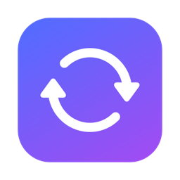

# QuickConvert

Right-click a file in Finder, pick a format, and the converted file appears next to the original. Everything runs locally with open-source engines. Nothing is uploaded.



## Ways to convert

| Where | How |
|---|---|
| Most folders | Right-click › **Convert to ›** *format* |
| iCloud Drive and other cloud folders (macOS hides Finder Sync menus there) | Right-click › **Services › Convert with QuickConvert…** |
| Anywhere | Drop files on QuickConvert.app, or open it and click **Choose Files…** |

While it's working, a menu-bar icon shows progress (a live percentage for audio and video) and has a **Cancel All** item. It plays a sound when done, shows an alert if anything failed, and quits when idle.

## Install

Requirements: macOS 13+, Apple silicon, Xcode command-line tools, an Apple Development signing identity (a free Apple ID works), and the engines:

```bash
brew install imagemagick ffmpeg poppler librsvg
brew install --cask libreoffice   # optional: Word/Excel/PowerPoint and anything → PDF
```

Then build, sign, install to `~/Applications` and enable the Finder extension:

```bash
./build.sh
```

If **Convert to** doesn't appear, check **System Settings › General › Login Items & Extensions › Finder** and switch QuickConvert on. To uninstall, run `./uninstall.sh`.

## Formats

| From | To | Engine |
|---|---|---|
| JPEG, PNG, WebP, HEIC, AVIF, GIF, TIFF, BMP, ICO, TGA, PSD, QOI, EXR, PPM | JPEG, PNG, WebP, HEIC, AVIF, GIF, TIFF, BMP, ICO, PDF | ImageMagick |
| SVG | PNG, JPEG, WebP, PDF | librsvg (+ ImageMagick) |
| PDF | PNG, JPEG (one image per page, 300 DPI) | Poppler |
| MP4, MOV, M4V, WebM, MKV, AVI, FLV, WMV, MPEG, 3GP | MP4, MOV, WebM, MKV, GIF, MP3, M4A, WAV | FFmpeg |
| MP3, WAV, FLAC, AAC, M4A, OGG, Opus, AIFF, WMA, CAF | MP3, M4A, WAV, FLAC, AAC, OGG, Opus, AIFF | FFmpeg |
| TXT, RTF, DOC, DOCX, ODT, HTML | DOCX, DOC, ODT, RTF, TXT, HTML (+ PDF with LibreOffice) | textutil / LibreOffice |
| PPTX, PPT, ODP, KEY | PDF, PPTX, ODP | LibreOffice |
| XLSX, XLS, ODS, CSV, NUMBERS | PDF, XLSX, ODS, CSV | LibreOffice |

With several files selected, the menu offers only formats that work for all of them.

## Quality

QuickConvert keeps as much quality as the target format allows:

- **No re-encoding when it isn't needed.** If the streams already fit the target container (say H.264/AAC from MOV to MP4, or AAC to M4A), they're copied bit-for-bit. That's lossless and nearly instant.
- **Lossless stays lossless.** PNG/TIFF/GIF/SVG → WebP uses lossless WebP. WAV/AIFF output is 24-bit.
- **When it has to re-encode:** JPEG quality 95 with full color resolution, photo WebP 95, HEIC/AVIF 90, H.264 CRF 18 (visually lossless), VP9 CRF 24, MP3 V0, AAC 256k, Opus 192k.
- **Kept:** photo metadata and color profiles (EXIF rotation is applied), every video and audio track, and subtitles where the container supports them. Album art is kept for MP3/M4A/FLAC.
- **Limits of the format itself:** GIF (256 colors; 960px wide, 15fps), ICO (256px max, square), and converting to a single-image format takes the first frame of an animation. Videos with odd dimensions lose one pixel row or column, because H.264 requires even sizes.

## Safety

- **Never overwrites.** Results go to `name.ext`, then `name 2.ext`, and so on, placed with a no-replace rename. A PDF's pages are published as a set.
- **Engines never see your filenames.** Each job works in a private temporary folder with fixed names, so names like `photo%03d.png` can't trigger ImageMagick/FFmpeg pattern expansion. Outputs are checked (they must exist, be non-empty, and have every PDF page) before anything appears next to your file. Failed jobs leave nothing behind.
- **Permissions carry over.** A private (`0600`) file produces a private output.
- **Only you can start conversions.** The Finder extension hands off jobs through its own sandboxed folder, which other apps can't write to, and the `quickconvert://` link carries only a one-time ID. A link from a website or another app can't name files. Services, drag-and-drop and the file picker are all started by you.
- **Bad input is rejected up front.** That covers missing files, folders, named pipes, unreadable files and format pairs QuickConvert doesn't support. Document engines are stopped if they stall (for example on a password-protected file), and **Cancel All** stops anything else.

## Tests

```bash
Tests/run.sh
```

This runs 56 end-to-end checks through the real engines on generated files, covering every target family, LibreOffice, concurrency, stream preservation, and all the safety rules above.

## Project layout

```
App/          Host app (unsandboxed): job intake, menu-bar progress, Converter (staging, engines, publishing)
Extension/    Finder Sync extension (sandboxed): builds the menu, writes job files
Shared/       Format catalog and job model used by both
Tests/        Test runner and end-to-end suite
Tools/        Icon generator
build.sh      Build, sign, install, register
uninstall.sh  Remove everything
```

## Known limits

- Apple silicon only. The engines are expected under `/opt/homebrew` or `/usr/local`.
- Signed for local use with an Apple Development certificate. Sharing it with other Macs would need Developer ID signing and notarization.
- Very large media files have no time limit (use **Cancel All**). Password-protected PDFs are reported as such and skipped.
- Folders aren't converted recursively. Select the files instead.
- Keynote (`.key`) import goes through LibreOffice and hasn't been tested. Numbers files have been tested (→ PDF and XLSX).
